<p align="center">
  
</p>

<h1 align="center">Artem Bondarenko // Cyborg Undefined</h1>
<p align="center"><strong>QA Engineer · Manual &amp; API Testing · Integration QA · AI-assisted Automation</strong></p>

<p align="center">
  <a href="https://vertical-unit.org/"></a>
  <a href="https://www.linkedin.com/in/artem-bondarenko-79146b185/"></a>
</p>

> I like finding the gap between how a system is supposed to work and how it actually behaves.

I'm a QA engineer with a background in software testing, C#/.NET automation and API integrations. My main focus is **manual, exploratory and API testing**, especially complex workflows, permissions, data integrity and the things that can break beyond the UI.

I also build AI-assisted tools and experiment with agent systems. I care about reproducible evidence, understandable failures and automation that engineers can trust.

## 01 / Current mission: Vertical Unit

[**Vertical Unit**](https://vertical-unit.org/) is an independent team of software engineers working on digital products, QA, integrations and AI automation.

I'm contributing to our engineering and QA work, including **OMNI**, an internal commercial intelligence platform in active development. Its goal is to connect data collection, AI-assisted research, signal verification and human-reviewed opportunity management.

```text
 PUBLIC SOURCES
       |
       v
 COLLECT & NORMALIZE --> AI RESEARCH --> VERIFY EVIDENCE
                                             |
                                             v
                                  HUMAN REVIEW / ACTION
```

Our wider team experience spans web platforms, mobile products, enterprise integrations and AI-assisted workflows. For external work, we prefer a clear scope, a useful deliverable and direct engineering communication.

[Visit Vertical Unit](https://vertical-unit.org/) · [Team on LinkedIn](https://rs.linkedin.com/company/vertical-unit)

## 02 / Quality engineering

| Focus | What I work on |
| :--- | :--- |
| **Manual & exploratory QA** | Functional testing, test design, regression, release verification, defect investigation and retesting |
| **API & integration QA** | REST, GraphQL, validation, error handling, state transitions and end-to-end data flows |
| **Security-focused QA** | Authentication, sessions, role-based permissions and data isolation within authorized scope |
| **Test automation** | C#/.NET, NUnit, RestSharp, HttpClient; experience with Selenium and Playwright |
| **Delivery & CI** | Jenkins, Docker, Bitbucket Pipelines, GitLab CI and reproducible test runs |
| **AI-assisted tooling** | Structured outputs, validation, retries, integrations, human review and workflow automation |

**Tools & technologies**

<p>
  
  
  
  
  
  
  
  
  
  
  
  
  
</p>

## 03 / Selected public repositories

| Project | What it demonstrates |
| :--- | :--- |
| [**RestApiTests**](https://github.com/BondarenkoCom/RestApiTests) | .NET API test design, request handling and JSON validation |
| [**QA WebSocket Project**](https://github.com/BondarenkoCom/QaAutomationWebSocketProject) | Testing real-time communication and events |
| [**Selenium Page Object Example**](https://github.com/BondarenkoCom/SeleniumPageObjectExample) | C# browser automation and page objects |
| [**AI Lead Ops Demo**](https://github.com/BondarenkoCom/n8n-ai-lead-ops-demo) | Sanitized n8n/.NET automation sample: lead intake, routing, CRM mock integrations and approval gates |
| [**AIJobSearcher**](https://github.com/BondarenkoCom/AIJobSearcher) | Job data collection, normalization, AI ranking and Telegram delivery |
| [**Amadeus Kurisu**](https://github.com/BondarenkoCom/amadeus-kurisu-bot) | Experimental character-based AI companion with conversational memory |

I also develop **Daily Fate**, an independent Android app currently in testing. Not every experiment is public, and not every prototype is a production system.

## 04 / Beyond the keyboard

```yaml
alias: Cyborg Undefined
class: Quality Engineer
side_quests:
  - AI companions and agent architectures
  - neurotechnology and brain-computer interfaces
  - game development and experimental interfaces
  - Japanese and English
  - trophy hunting
favorite_universes:
  - Ghost in the Shell
  - Deus Ex
  - Blade Runner
  - NieR
  - Steins;Gate
  - Dead Space
long_term_goal: work on brain-machine interfaces and neuroprosthetics
```

I'm fascinated by cyberpunk, science fiction and the boundary between human cognition and machines. My interest in neurotechnology is a long-term research and learning direction, not a claim of clinical or neuroscience expertise.

I enjoy games not only as entertainment but also as systems to explore: mechanics, hidden rules, emergent behavior and the stories they can tell.

## 05 / Experimental archive

**HexNest** · Multi-agent reasoning network experiment. **On hold.**

An earlier exploration of agent collaboration, structured reasoning, MCP and A2A. The project is no longer my main focus, but its technical lessons remain part of my engineering journey. The public [node runtime](https://github.com/BondarenkoCom/hexnest-node) remains available for reference.

## 06 / Contact

Open to conversations about remote QA, API and integration testing, AI-assisted automation and collaborative engineering projects.

- **Personal:** [LinkedIn](https://www.linkedin.com/in/artem-bondarenko-79146b185/)
- **Team:** [Vertical Unit](https://vertical-unit.org/) · [LinkedIn](https://rs.linkedin.com/company/vertical-unit)

<p align="center"><sub>BUILD · BREAK · UNDERSTAND · REPEAT</sub></p>
